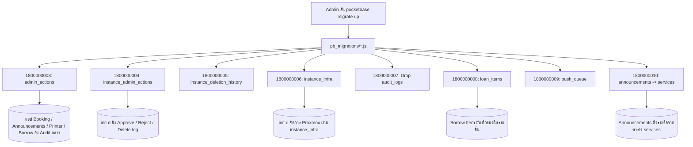

# pocketbase-audit — เรียกแล้วโค้ดไปไหน

โปรเจกต์นี้เป็นชุด Data Migration & Architecture ของ PocketBase ภาควิชา CS KMITL

| ผู้ดูแลทำอะไร | ไฟล์ที่รัน | ผลลัพธ์ในฐานข้อมูล |
| :--- | :--- | :--- |
| **สร้าง Audit Log กลาง** | [1800000003_create_admin_actions.js](pb_migrations/1800000003_create_admin_actions.js) | สร้างคอลเลกชัน `admin_actions` เก็บประวัติการตัดสินใจของทุกแอป |
| **สร้าง Audit VM** | [1800000004_create_instance_admin_actions.js](pb_migrations/1800000004_create_instance_admin_actions.js) | สร้างคอลเลกชัน `instance_admin_actions` สำหรับ Approve/Reject/Delete VM |
| **แยกประวัติลบเครื่อง** | [1800000005_separate_deletion_and_clean_instances.js](pb_migrations/1800000005_separate_deletion_and_clean_instances.js) | สร้าง `instance_deletion_history` และลบ 7 ฟิลด์ขยะออกจาก `instances` |
| **แยกข้อมูล Proxmox** | [1800000006_separate_infra_collection.js](pb_migrations/1800000006_separate_infra_collection.js) | สร้าง `instance_infra` (1-to-1) ย้ายฟิลด์ infra ออกจาก `instances` (36 -> 20 ฟิลด์) |
| **ลบตารางเก่า** | [1800000007_drop_audit_logs.js](pb_migrations/1800000007_drop_audit_logs.js) | ลบตาราง `audit_logs` โบราณที่เลิกใช้แล้ว |
| **แตกตารางยืมของ** | [1800000008_create_loan_items.js](pb_migrations/1800000008_create_loan_items.js) | สร้าง `loan_items` และแปลงของยืมเดิม 20 ชิ้นเป็น Normalized rows |
| **สร้างคิวแจ้งเตือน** | [1800000009_create_push_queue.js](pb_migrations/1800000009_create_push_queue.js) | สร้าง `push_queue` รวมท่อส่ง Push Notification ของทุกแอป |
| **เชื่อมโยงบริการ** | [1800000010_link_announcements_to_services.js](pb_migrations/1800000010_link_announcements_to_services.js) | เพิ่ม relation `target_services` ใน `announcements` ผูกกับ `services` collection |
