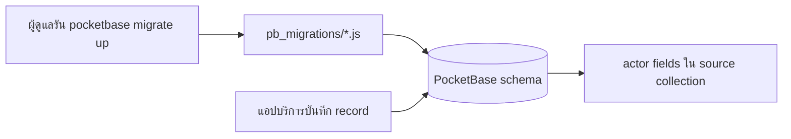

# pocketbase-audit — เรียกแล้วโค้ดไปไหน

โปรเจกต์นี้ไม่มี UI ให้กด เป็นชุด migration ของ PocketBase

| ผู้ดูแลทำอะไร | ตามไฟล์ | ผลลัพธ์ |
| --- | --- | --- |
| รัน `pocketbase migrate up` | [README.md](README.md) → [1800000000_create_audit_logs.js](pb_migrations/1800000000_create_audit_logs.js) | สร้าง collection audit logs |
| migrate ขั้นต่อไป | [1800000001_add_instance_approval_actor_fields.js](pb_migrations/1800000001_add_instance_approval_actor_fields.js) และ [1800000002_add_portal_actor_fields.js](pb_migrations/1800000002_add_portal_actor_fields.js) | เพิ่ม actor fields ใน collection ต้นทาง |
| แอปบันทึกข้อมูลหลัง migrate | ตัวแอปเขียน actor fields เอง; [audit-logs.pb.js](pb_hooks/audit-logs.pb.js) เป็น hook ว่าง | ไม่มี global hook คอยสร้าง audit log อัตโนมัติ |
